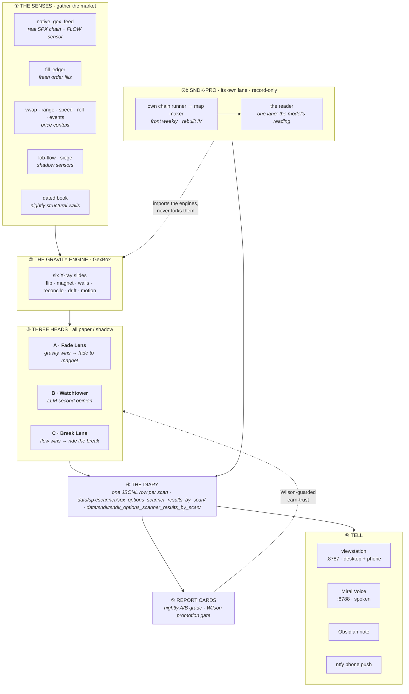

# mirai-station

**An always-on research system that watches options dealer positioning and, minute
by minute, writes down what it thinks price will do — on paper.** It runs
unattended on a Mac mini, trades no real money, and only earns the right to alert
(let alone trade) once its own nightly report cards prove it beats luck.

> **Status: paper / shadow, everywhere.** Every engine, head, and sensor writes to
> a diary and is graded; nothing is live. The gate from paper → live is a
> Wilson-guarded win-rate check the record has not yet cleared — by design.

Two words carry the whole model:

- **GRAVITY** — dealer *positioning*: where hedging flows *pull* price (the magnet,
  the walls, the gamma-flip line, the long/short-gamma regime).
- **FLOW** — the live *force*: who is *shoving* price right now (aggressor tape,
  order-book pressure).

The core question is always the same: **does gravity hold price to its magnet, or
does flow overpower it and break away?**

Wherever a wall, magnet, or pin is *labeled* in a rendered view it uses the standard
notation from **`docs/glossary/gw-vocab.md`**: `GWc`/`GWp` (call/put gex walls), `MagP`
(magnetic pull), `Pin`, each with a `'` `''` `'''` intensity mark and a tenor prefix
(`[0DTE]`, `[1-7DTE]`, `[AUG21]`-style dates).

---

## What's in the box

The station is not one program — it's a small fleet of independent pieces that share
a vocabulary, a state directory, and one launchd scheduler. Each has its own
lifecycle, its own kill switch, and its own posture.

| # | Piece | What it is | Ticker | Posture |
|---|---|---|---|---|
| 1 | **The SPX station** | The original system: senses → gravity engine → three heads → diary → report cards | SPX | paper |
| 2 | **SNDK-PRO** | A second, fully isolated GEX station for a single equity name, with its own model-written reading | SNDK | record-only |
| 3 | **SIEGE** | Shadow sensor: underlying volume spent *at* a wall, and whether that predicts the break | SPY→SPX | shadow |
| 4 | **LOB-FLOW** | Shadow sensor: Layer-2 order-book pressure | SPY | shadow |
| 5 | **Dated Book** | Nightly sidecar for far-dated structural OI walls the 0–7 DTE live fetch can't see | SPX | record-only |
| 6 | **The viewstation** | The read-only web view of everything above, on `:8787`: the desktop page and the phone pages | — | read-only |
| 7 | **Mirai Voice** | Ears + mouth: hold a spoken conversation about the SNDK board, on `:8788` | SNDK | live tool |
| 8 | **Report Cards** | The after-close grader and the single Wilson gate between paper and live | all | the referee |

Isolation is a design rule, not an accident: **SNDK-PRO imports the SPX engines and
never forks them**, SIEGE and LOB-FLOW are self-contained boxes that hand results
*in*, and the Dated Book runs in its own process against its own store so it cannot
change the scan's input distribution.

---

## The shape in one picture



Read it top to bottom: the **Senses** gather real option-book data and live flow →
the **Gravity Engine** turns it into a dealer map → **three heads** each make a paper
call from that map → every scan is written to the **Diary** → **Report Cards** grade
the record after the close, and the Wilson gate is the *only* path that could ever
let a head go live. **SNDK-PRO runs beside all of it** on its own feed, its own
schedule, and its own store — borrowing the engines, touching nothing.

---

## 1 · The SPX station

### The live loop (every minute during market hours)

A launchd agent wakes every 60 s and gates itself to RTH (Mon–Fri 09:30–16:00 ET;
the gate is a self-contained NYSE calendar, no network call). Each real tick runs
two phases:

1. **Scan** — `hunter.py` (the *Shift Manager*) runs the scan on **SPX**:
   - the **Flow Sensor + Gravity Engine** read first and hand up the magnet, σ,
     walls, and regime;
   - the **three heads** each evaluate that map;
   - `record()` appends one row to today's **diary** (`data/spx/scanner/spx_options_scanner_results_by_scan/<date>.jsonl`);
   - the Obsidian "Today" note and the viewstation refresh.
2. **Alerts** — `watch.cli gex-alerts` runs *always* (after hours too): fresh paper
   fires, the wall-breach bell and the feed sirens push to the phone via **ntfy**.

Report cards are **not** part of the tick — they run as a separate nightly job after
the close.

### The three heads

All three are **shadow / paper only** (`REVERSION_LIVE = False`). A "fire" is a diary
entry, not an order.

| Head | Code key | Thesis | Fires when… |
|---|---|---|---|
| **A · Fade Lens** | `reversion_extreme` | GRAVITY wins — price snaps back to the magnet | four gates all pass: **stretched** (σ from close / VWAP / wall), **pinning** regime, **reaction** (last bar turns back), and **runway** to the magnet |
| **B · Watchtower** | `watchtower` | an independent LLM "second opinion" that forecasts direction from the map | blind-then-reveal, 3-vote majority, `claude-sonnet-5` pinned by exact id, capped 35 judged scans/day. Since **wt-11** it may reach for exactly two tools — its own history CLI (`lefteye_rag.py` → `data/spx/scanner/spx_options_scanner_claude_notes_by_read/`, its past reads as searchable memory) and WebSearch for the catalyst behind a genuinely abnormal tape — doctrine-gated, history is context never the trigger. **Never touches the phone and can never place or veto a trade** — it exists only to be graded |
| **C · Break Lens** | `level_reclaim` | FLOW wins — a weakened map is overpowered and price breaks away | a two-stage *cock → fire*: gravity cocks the hammer on a rejection at the storm side; live one-way flow fires it. Recording-only |

The Fade Lens and Break Lens are opposite twins — one bets the pin holds, the other
bets it breaks. When they disagree, the hunter marks a `referee` note in the diary.

The Watchtower's prompt is versioned by **era** (`wt-11` current — the SNDK
sr-2→sr-5 honesty port, every threshold re-measured on the SPX tape;
`docs/research_and_reviews/spx-payload-inventory.md` is the field-by-field scene inventory and
`docs/research_and_reviews/wt8-doctrine.md` records the wt-8-era reasoning foundations). Bump the
era on any change to the payload or the prompt so a later read of the record
can never blend two rule sets.

### The Gravity Engine (`GexBox`)

One orchestrator (`lefteye_gex_box.py`) fetches the option chain only when it changed
and re-prices it every scan into six "X-ray slides":

- **A · flip** — the banded zero-gamma zone; regime = sign of net gamma at spot.
- **B · magnet + walls** — today's 0DTE pull-strike (the MagP level, signed net-GEX)
  and the volume-weighted call/put walls ([0DTE]GWc / [0DTE]GWp).
- **C · terrain** — the stable OI-weighted structural walls ([1-7DTE]GWs).
- **D · volume overlay** — fills in empty-OI 0DTE strikes.
- **E · reconcile** — cross-checks the regime tag against live aggressor flow,
  direction-aware: a heavy buy-calls/sell-puts tape **inverts** the assumed dealer
  sign and marks the regime **UNCERTAIN** (a heavy confirming tape never trips). A
  near-balanced book at spot also reads **UNCERTAIN** — a tie, not a regime.
- **F · drift** — vanna (VEX) and charm (CEX) slow pressure into the close.

Plus a **motion** pack (`gex_motion`: walls melting, magnet walking, flip line
creeping) — the map read as film, not a photo — and a one-candle **shove test**.

When the native chain is unavailable it degrades to a **labeled** SPY-proxy: SPY's
book rescaled ×10 into index space.

---

## 2 · SNDK-PRO — the isolated equity station

A second GEX station for **SNDK** (~$1,250, $5 strike grid, weekly Friday expiries),
built to prove the engines generalize off the index. It **imports** the pure left-eye
engines (`build_views`, `slide_0dte`, `dex_views`, `profile_ladder`) and the hardened
MCP transport — never forks them — and keeps every SNDK-specific rule in its own
directory. Nothing here trades, alerts, or feeds any SPX consumer.

Three facts drove its design (all live-verified, all covered by tests):

1. **Weekly expiries, not dailies.** "No expiry today" is the normal state 4 days of
   5, so the coverage teeth bite on the **front** expiry instead. Bulk expiry
   discovery is broken for SNDK, so candidate days are probed one at a time and the
   verdict is cached for the day.
2. **The chain's own spot is ~15 % stale.** Every strike window and spot-relative
   read anchors on the Schwab live quote — **no live quote → no book, no row**
   (fail-closed). The strike window is vol-adaptive, because SNDK runs ~105 % IV
   where a fixed ±8 % band would truncate the magnet's own reach.
3. **Provider IVs are computed off that stale spot** and are garbage near the money.
   IV is **rebuilt** per strike from the live bid/ask mid of the OTM right and shared
   with its parity twin; gamma is recomputed from the rebuilt IV.

**One lane, on purpose (obs-3).** The deterministic arrow — Lane A — was removed on 2026-09-01: it was a direction surface on a system whose redesign measured the direction call at zero forward value, its own content pointed at the nearest round hundred on 94% of audited episodes, and its state changes spent 11% of model calls waking an observer that was forbidden from ever seeing it. The model's reading is the only live lane; old read rows keep their `arrow` field as history.

The blunt findings that shaped it — measured over four recorded sessions, 756 rows:
12 of ~20 candidate payload fields were **constants** (one read *"Dealers sell into
strength"* on 756/756 rows, through a **+12 %** day); the magnet is a **tie** more
often than not, so it ships as a band, never a scalar; the old arrow pointed **8×
further than price travels** in the window it implied. Nothing on this surface is
outside the noise band, and nothing here is presented as an edge.

A **pause** switch (`data/sndk/sndk_options_reader_reasoning_switch.json`, flipped from the viewstation's SNDK tab) silences
the model's *sentence* and nothing else — the gates and rankings are pure
functions of a row already on disk, so every scan still lands a row, stamped
`paused: true`. A gap in a training set costs more than a gap in the prose. Both
readers fail **open**.

Details: `pipelines/sndk_options_scanner_and_reader/README.md`.

---

## 3 · SIEGE — effort at the towers *(shadow)*

A self-contained sensor box measuring one thing: how much underlying volume gets
spent while spot is **touching** a dealer-gamma level, and whether that effort
predicts the level breaking or holding.

> **The sign is reversed, and that is the whole point.** Backtest sweep (n = 168
> touches, 11 of 13 days agreeing): **high volume at a wall touch predicts the wall
> BREAKS.** Sieged walls held 39 % of the time vs 54 % for quiet touches. The
> intuitive read — "defenders absorbing heavy volume = strong level" — is the wrong
> sign on this tape. Never flip the labels back without a new sweep.

`SIEGE` (effort ≥ 70th pct) → expect break · `QUIET` (≤ 30) → expect hold ·
`NEUTRAL` in the middle. Wired into the Watchtower payload since wt-7; graded
record-only. Details: `data_collectors/spy_volume_at_walls_sensor/README.md`.

## 4 · LOB-FLOW — order-book pressure *(shadow)*

A Layer-2 order-book FLOW sensor, collected on its own 60 s job and folded nightly.
Distinct from the options aggressor tape: this measures the *stock* book. Promotion
gate dormant. Details: `data_collectors/spx_options_tape_collector/README.md`.

## 5 · The Dated Book sidecar *(record-only)*

The live fetch is 0–7 DTE only, so multi-month structural OI walls (the 7000/8000-class
round numbers sitting on every monthly) are visible only during OpEx week and vanish
the rest of the month — while persisting in the market. This sidecar pulls exactly two
extra bands nightly (the next two AM 3rd-Friday monthlies, the next two SPXW
quarter-end expiries) into its own store.

Its blast-radius contract is the design: **separate process** (never inside a scan
tick — the scan side is a cache-only file read), **separate store**, **magnitude only**
(no signed field to misuse, since assumed sign disagrees with flow-inferred sign ~44 %
of the time), and **fail-open** (an error leaves the last good book untouched).

---

## 6 · The viewstation

A read-only web app on **`:8787`** showing the live state on the mini: one desktop page
(the SPX map, layers, diary, processor, replay and dictionary tabs, and the SNDK tabs
beside them) and the phone pages under `/m`. It reuses the project's own renderers, so
every number matches the canonical views. Reaching the port directly, by LAN or tailnet
address, gets you everything; the front door for anything further away is a Cloudflare
Tunnel into Caddy, which holds the password and proxies here. Never forward the port
itself. Details: `screens/desktop_and_phone_server/README.md`.

## 7 · Mirai Voice — the desk, spoken

Press the talk button on the SNDK tab and hold an open conversation about the board.
A WebSocket sidecar on **`:8788`** with server-side VAD turn-taking, barge-in, and a
3-minute auto-off.

| Organ | What it does |
|---|---|
| **Ears** | Parakeet (MLX) — PCM in, transcript out, ~160 ms, plus a jargon fixer ("jex" → GEX, "san disk" → SNDK) |
| **The mind-link** | One `ClaudeSDKClient` session held open per trading day (subscription auth, streaming), so a turn costs no CLI spawn; injects the reader's own scene per turn; the RAG history CLI is its only tool |
| **Mouth** | Kokoro TTS at 24 kHz, `say` fallback |

Scope: **SNDK only, by doctrine.** The mic needs a secure context — localhost on the
Mac works today; the iPad needs the HTTPS cert step. Details:
`screens/voice_desk/README.md`.

## 8 · Grading & the earn-trust gate

`gex_polarity_ab.py` (the *Report Cards*) runs after the close and grades every shadow
engine and head — `gex_views` (proxy), `gex_theta` (native), the LOB `lob_flow` /
`spy_depth` sensors, SIEGE, the Watchtower, and the two lenses — target-before-stop
against 1-min bars, scoring both **direction polarity** and **magnet gravitation**.

Its `promotion_gate()` is a **Wilson lower-bound** check; `reversion_lens.live_allowed()`
reads it, and it is the single gate between paper and live. **Nothing has cleared it.**

---

## Data providers

| Provider | Supplies | Auth |
|---|---|---|
| **ThetaData** (via Cassandra's Edge MCP) | the **native SPX option chain** — the primary GEX source — the SNDK chain, and a Schwab-independent 1-min price path | AuthKit OAuth since 2026-09-09: a Keychain **refresh** token (`iv-viability-cassandra`) spent per scan for a 300-second access token. Enrol with `native_gex_feed.py --login` |
| **Schwab** (`schwab-py`) | daily/1-min bars, live quotes, the SPY chain (the ×10 proxy) | Keychain OAuth (7-day token, kept alive by `auth-watch`) |
| **Claude** (subscription) | the Watchtower vote and the SNDK reading via one-shot `claude -p`; the voice conversation via a held-open `claude-agent-sdk` day session (a CLI spawn costs 7–100 s — far too slow to speak) | Claude Code CLI login — **no API key** |

The whole option-book foundation lives immutable in `data/spx/scanner/`
(`spx_options_strike_volume_weights_state.json`, `spy_options_strike_volume_weights_state.json`); everything downstream re-prices off it.

---

## Layout

One project home, `~/mirai_awakening`, every folder named for what it holds (since
2026-10-11; `docs/system_map.md` maps each folder to its jobs, entry points and tests):

```
mirai_awakening/
├── station_paths.py            every data store named once (its name → its place under data/); jobs, server and pages ask it
├── pipelines/
│   ├── spx_options_scanner/    the SPX brain (the left eye): hunter · reversion_lens (3 heads) ·
│   │                           lefteye_gex_box (Gravity Engine) · native_gex_feed
│   │                           (FLOW sensor) · watchtower · dated_gex_feed (sidecar) ·
│   │                           lefteye_dex (direction-side twin, shadow) ·
│   │                           profile_ladder + adaptive_em (display, shadow) ·
│   │                           fill_ledger · gex_polarity_ab (grader) ·
│   │                           siege_bridge · lob_bridge · dashboard · price lenses
│   ├── spx_jev_questions_and_pools/   the SPX JEV decision service (spx_jev), its feeds, the
│   │                           headlines feed and the Mirai Prediction System
│   ├── spx_claude_forecast/    the Claude read over a frozen payload: recorder · nightly
│   ├── sndk_options_scanner_and_reader/   the isolated SNDK station: feed · views · hunter ·
│   │                           read (model reading) · rag (on-demand memory)
│   └── shared_text_embedder_for_note_search/   embed.py, the bge-small embedder the two memories rank with
├── data_collectors/
│   ├── schwab_live_stream/          the one Schwab streaming connection: SPY book, SPXW focus set, $SPX live price
│   ├── schwab_market_data_client/   the Schwab sign-in, token vault and fetchers every pipeline imports
│   ├── spx_options_tape_collector/  lob_flow: the same-day SPX options tape and depth collector (shadow)
│   └── spy_volume_at_walls_sensor/  siege: SPY volume spent at dealer walls (shadow)
├── screens/
│   ├── desktop_and_phone_server/    read-only HTTP on :8787: the desktop page + the phone pages (static/m/)
│   ├── desktop_options_trades_3d_view/   book_flow: the Day Visual LOB board, the SPX options tape as price × time
│   ├── android_phone_app/      the Android shell that opens the phone pages
│   └── voice_desk/             ears · jargon · convo · doctrine · mouth · voice_server (:8788)
├── alerts_and_phone_pushes/
│   ├── watch/                  the watch package: cli · paths · push ·
│   │   └── intraday/           market_status · gex_alerts · push_ntfy · auth · the dead-man's switches
│   └── tests/
├── settings/                   limits-and-cooldowns.json
├── scheduled_jobs/
│   ├── launchd_job_definitions/   25 LaunchAgent plists (the fleet, below)
│   └── job_start_scripts/      env.sh (Keychain reader) · start_job_with_logs.sh · the run-*.sh runners · install · venv
├── health_checks/              the live health review and its unit tests
├── skills/sndk-jev/            the SNDK JEV decision service (TypeSafe), retired 2026-10-11: no job runs it; the folder goes next
├── data/                       runtime-mutable, git-ignored — never copied between machines (station_paths.py is the one place that
│                               knows the layout; docs/data_map.md is the one page that explains every store)
│   ├── market/                 prices, quotes, depth, trades, open interest, the calendar, and their tables/
│   ├── spx/scanner/            the SPX options scanner (the left eye), the order-flow readings, the wall sensor, the Watchtower's memory
│   ├── spx/jev/                the JEV lanes (live_lane · opening_lane · premarket_lane), the shared archive, its tables/
│   ├── spx/prediction/         the base pool, the learner pool, the code questions' answers, the forecasts and their tables/
│   ├── spx/claude_forecast/    Claude's own SPX forecast: its record, its tables/, its rulebooks
│   ├── sndk/                   the SNDK scanner, its reader and the reader's memory
│   ├── voice_desk/             the voice desk's transcripts + session continuity
│   ├── screen_files/           phone/ cards and the desktop/ 3D view, written only for a screen
│   ├── operations/             logs/ (every job's output and errors) · locks/ · health/ · the alert states
│   └── archive/                rollback copies and retired data, dated at archiving
└── docs/                       system_map · data_map · how_to_run/ (INSTALL · OPERATIONS) · glossary/ (gex-glossary · gw-vocab) ·
                                research_and_reviews/ (wt8-doctrine · the two payload inventories · sndk-plan · salvage-notes)
```

### The launchd fleet (25 agents)

`scheduled_jobs/job_start_scripts/install-launchd.sh` names every agent it loads (`PLISTS`); that list is
the fleet.

| Label | Cadence | Job |
|---|---|---|
| `left-eye` | every 60 s (gated to RTH) | the SPX scan + alert tick |
| `sndk` | every 120 s (gated to RTH) | the SNDK scan tick |
| `sndk-read` | every 120 s (gated to RTH) | the SNDK reading — **its own job on purpose**, so a hung model call can never eat a diary row |
| `sndk-bars` | every 60 s (gated to RTH, plus 12 min after the close) | SNDK's finished minute bars — its own job, so the price record survives a stuck scanner |
| `sndk-deadman` | every 5 min | pages the phone when the SNDK scanner or its reader stops writing |
| `lob-collector` | every 60 s | Layer-2 LOB flow collector (shadow) |
| `viewstation` | continuous | the viewstation HTTP server on :8787 (desktop + phone) |
| `voice` | continuous | the voice WebSocket sidecar on :8788 |
| `caffeinate` | continuous | keeps the mini awake |
| `auth-watch` | 08:00 ET | Schwab token keep-alive + dead-bearer ping |
| `dated-book` | 08:17 ET daily, + Fri 17:10 ET | the far-dated structural-wall sidecar |
| `gex-polarity` | 16:15 ET | after-close A/B grader + LOB nightly fold |
| `spx-jev` | :02 and :32 ET, 09:32 to 16:02 (gated to RTH; the 16:02 fire only grades) | the SPX JEV decision service beside the SPX diary: labels, asks JEV, sums and grades, writes the live lane under `data/spx/jev/`, the learning loops under `data/spx/prediction/` and its card under `data/screen_files/phone/` — its own job, never on the scan path (`pipelines/spx_jev_questions_and_pools/README.md`) |
| `spx-jev-tape` | every 5 min 09:35 to 10:30 ET, and 10:42 (gated to RTH) | SPX JEV's opening lane |
| `spx-jev-premarket` | 02:35, 03:35 (04:35 in Frankfurt's winter-time week), 08:05, 08:48, 09:05, 09:28 ET, and 10:06 | SPX JEV's lane before the open, from the night's futures; 10:06 is its close-out |
| `spx-premarket-deadman` | every 5 min | pages a pre-market checkpoint with no read, or a close-out not landed or leaving a call ungraded |
| `spx-jev-bars` | every 60 s (gated to RTH, plus 13 min after the close) | SPX's finished minute bars for SPX JEV |
| `spx-jev-context` | every 60 s (gated to RTH) | the market around SPX (breadth, VIX family, futures, rates, sectors, megacaps) for SPX JEV |
| `spx-jev-save-day` | 16:20 ET | the day's full minute bars of every market-feed symbol |
| `spx-jev-overnight` | 09:26 and 16:20 ET | the overnight futures (/ES, /ZN, /BTC, /MBT) and the roll table |
| `spx-jev-headlines` | every 3 min, 07:00 to 16:30 ET weekdays | four public RSS feeds, each new item stamped with the poll's own clock under `data/market/news_headlines_by_article/`, for the judgment questions |
| `spx-jev-store` | 16:40 ET | SPX JEV's learning store, rebuilt from its raw files into checked Parquet |
| `spx-jev-prediction-nightly` | 17:05 ET weekdays | the Mirai Prediction System's nightly job: its tables, the voice scores, the learner pool's learning, the learners' refit and the phone's scoreboard, under `data/spx/prediction/` (the scoreboard card under `data/screen_files/phone/`) |
| `spx-claude-forecast-recorder` | 08:40 and 16:25 ET, plus Fri 17:30 ET | records what no other job keeps (the $VIX1D close, SPX 5-minute bars, the leveraged funds' sizes) into `data/market/` and mirrors the forecast folder and the irreplaceable `data/market/` stores (those three, the open-interest history, SPY's volume per minute, the finished raw tape days) to iCloud |
| `spx-claude-forecast-nightly` | 17:15 ET weekdays | seals what happened after every Claude read, rebuilds the library of past moments, scores every forecaster, writes the scorecard |

### Kill switches

Every optional subsystem can be turned off without touching code. Those that own a
launchd job are checked in the shell wrapper **and** again in Python, so neither path
can be missed.

| Variable | Silences |
|---|---|
| `WATCHTOWER_DISABLE=1` | the LLM second opinion |
| `SNDK_PRO_DISABLE=1` | the SNDK scanner (**and**, implicitly, its reading — with no fresh rows, reading on would only re-narrate a frozen book) |
| `SNDK_READ_DISABLE=1` | the SNDK reading only |
| `SPX_JEV_DISABLE=1` | SPX JEV and all eleven of its jobs (checked in each `run-spx-jev*.sh` runner and the pre-market dead-man's, which exit 0); the two Claude forecast jobs stand down with it, since there is nothing to forecast |
| `SPX_JEV_PREDICTION_DISABLE=1` | the Mirai Prediction System's nightly job only |
| `SPX_CLAUDE_FORECAST_DISABLE=1` | the Claude forecast's recorder and nightly jobs (checked in their runners and again in Python) |
| `MIRAI_VOICE_DISABLE=1` | the voice sidecar |
| `DATED_BOOK_DISABLE=1` | the far-dated sidecar |
| `SIEGE_DISABLE=1` | the effort-at-the-wall sensor |
| `MAGNET_V3_DISABLE=1` | falls the magnet back to the pre-v3 rule |

The SNDK reasoning **pause** is deliberately *not* a kill switch — see §2.

---

## Quickstart (Mac mini)

```bash
cd ~/mirai_awakening
./scheduled_jobs/job_start_scripts/venv-bootstrap.sh      # provision ~/.local/share/mirai-station/venv
./scheduled_jobs/job_start_scripts/install-launchd.sh     # symlink + bootstrap the 25 agents
```

Then:

Always name the venv interpreter explicitly. There is only one interpreter with
`schwab-py` + `httpx`, and nothing here is meant to run under a system `python3` —
but the shebangs are `#!/usr/bin/env python3` (an absolute path would hardcode one
machine's home directory), so `./script.py` gets system python and most signal
modules silently fail. The launchd path is unaffected: every `run-*.sh` calls
`"${MIRAI_STATION_VENV}/bin/python"` explicitly.

```bash
PY=~/.local/share/mirai-station/venv/bin/python

./scheduled_jobs/job_start_scripts/run-watch-left-eye.sh                    # one SPX tick by hand
$PY pipelines/sndk_options_scanner_and_reader/sndk_hunter.py --force                 # one SNDK tick, off-hours
$PY pipelines/sndk_options_scanner_and_reader/sndk_read.py --replay YYYY-MM-DD       # re-run a recorded day, writes nothing
$PY screens/voice_desk/repl.py --mute                      # the whole voice loop in a terminal
```

Tests — **one suite directory at a time** (each box ships its own `conftest.py`, and
they collide if collected together):

```bash
for t in pipelines/spx_options_scanner/tests pipelines/sndk_options_scanner_and_reader/tests \
         pipelines/spx_jev_questions_and_pools/tests pipelines/spx_claude_forecast/tests \
         data_collectors/spy_volume_at_walls_sensor/tests data_collectors/spx_options_tape_collector/tests \
         data_collectors/schwab_market_data_client/tests screens/voice_desk/tests \
         screens/desktop_options_trades_3d_view/tests screens/desktop_and_phone_server/tests \
         alerts_and_phone_pushes/tests health_checks; do
  $PY -m pytest "$t" -q
done                                                       # ~4,400 tests
```

Before you commit — the pre-push hook refuses anything else:

```bash
git config core.hooksPath .github/hooks                     # the scrub gate, at commit and at push
git config user.email fivestone14@users.noreply.github.com  # repo-local; a real address is refused
export TZ=UTC                                               # commit dates must read +0000
```

- **Full setup** (auto-login, Caffeinate, Keychain secrets, MCP servers, ntfy):
  `docs/how_to_run/INSTALL.md`
- **Moving to new hardware**: `docs/how_to_run/INSTALL.md`, the section of that name
- **Runbook** (start/stop, logs, troubleshooting): `docs/how_to_run/OPERATIONS.md`
- **System map** (every folder → its jobs, entry points and tests): `docs/system_map.md`
- **Data map** (every store → its path, what one row holds, who writes and reads it, the training sets and their join keys): `docs/data_map.md`
- **Plain-name glossary** (every code identifier → what it actually does):
  `docs/glossary/gex-glossary.md`
- **Label notation** (`GWc`/`GWp`/`MagP`/`Pin` + primes): `docs/glossary/gw-vocab.md`
- **Watchtower reasoning doctrine** (wt-8-era foundations): `docs/research_and_reviews/wt8-doctrine.md`
- **SPX scene, field by field** (wt-11): `docs/research_and_reviews/spx-payload-inventory.md`
- **SNDK scene, field by field**: `docs/research_and_reviews/sndk-payload-inventory.md`

- **Research and reviews moved in from the old Desktop map** (2026-10-11): `docs/research_and_reviews/`
  (JEV research, SPX JEV question research and reviews, the Watchtower note); the payload diagram is
  `docs/diagrams/`; the phone-push setup is `docs/how_to_run/phone_push_setup_and_format.md`.
- **Page and diagram builders** (artifact dev aids, never committed): `docs/artifact_and_diagram_builders_not_in_git/`.

`~/Desktop/Mirai-Awakening/` now holds one shortcut, `mirai_awakening`, to this folder. The old
numbered map (its shortcuts and plain-English READMEs) is kept in
`data/archive/2026-10-11_desktop_map_folder/`; the folder names here say what they hold instead.

---

## History

Restructured **2026-07-03** into a gex-only system: the nine-voter confluence brain,
the real-trade pick builder, and the bet watcher were retired (the Fade Lens is the
brain now). An earlier "Mirai Watch" LangGraph tick-graph and a LanceDB news store
went with them. Treat anything mentioning *voters / confluence / pick_builder /
outcomes / oracle / algo-read / langgraph* as historical — the live shape is the one
this README describes. What the retired system did, and what's worth bringing back,
is recorded in `docs/research_and_reviews/salvage-notes.md`.

**mirai-station is the always-on twin.** The interactive vault stays on the main
machine; the mini emits alerts and writes its own `data/` — cross-machine vault sync
is intentionally out of scope.
